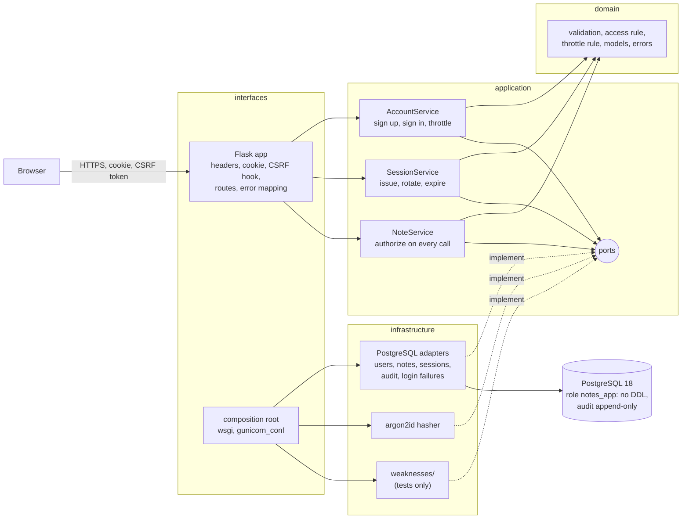

# Architecture

A small notes application and the evidence that it is hardened. The shape follows the lesson's diagram: a browser, a web server with a session cookie and a CSRF token, a service layer that asks "does this user own or share this note?", and a database. Each arrow is a trust boundary, and each boundary has controls with a test behind them ([docs/THREAT_MODEL.md](docs/THREAT_MODEL.md)).

## Pattern: ports and adapters, with the rule at the centre

The system has three boundaries (HTTP in, database out, the password hasher), so the code is layered as ports and adapters:

| Layer | Folder | Owns | May import |
| --- | --- | --- | --- |
| Domain | `src/notes_app/domain/` | value objects (`User`, `Note`, `Session`, `AuditEvent`), validation, the access rule (`access_to_note`), the throttle rule (`retry_after_seconds`), named errors | the standard library only |
| Application | `src/notes_app/application/` | use cases (`AccountService`, `SessionService`, `NoteService`), the ports they need (`ports.py`), the production access policy | domain |
| Infrastructure | `src/notes_app/infrastructure/` | PostgreSQL adapters, argon2 hasher, settings, JSON logging, the clock and token source, and `weaknesses/` | application, domain |
| Interfaces | `src/notes_app/interfaces/` | the Flask app, security headers and cookie, the composition root, gunicorn and WSGI wiring, the health and demo programs | everything below |

Nothing imports `interfaces`. `make lint` enforces the direction with import-linter, and a second contract keeps Flask, werkzeug, Jinja, psycopg and argon2 out of `domain` and `application`, so the rules that matter most to security can be tested without a web server or a database. The authorization check is the clearest case: the rule is a pure function in the domain, the service applies it on every request, and the adapter that stores notes knows nothing about who may see them.

## Components

Drawn versions of this figure and of the walk-through: [the architecture](docs/diagrams/architecture.svg) and [one run](docs/diagrams/flow.svg).

## One request, step by step: `PATCH /notes/42` by a signed-in user

1. The browser sends the request with the `__Host-session` cookie and an `X-CSRF-Token` header over HTTPS (a proxy in front terminates TLS).
2. `load_session` reads the cookie, hashes it with SHA-256 and asks `SessionService.resolve`. The service looks the hash up, checks the absolute expiry (8 hours) and the idle limit (30 minutes) against an injected clock, and refreshes `last_seen_at` at most once a minute. An unknown, expired or idle value resolves to no session.
3. `enforce_csrf` sees an unsafe method. It compares the header with the session's CSRF token in constant time. A missing or wrong token raises `CsrfRejectedError`, writes a `csrf.rejected` audit row and answers 403 before any route runs.
4. The route reads the JSON body as plain values and calls `NoteService.update(user_id, 42, title, content, ip)`. The user id comes from the session, never from the request body.
5. `NoteService` loads note 42 and its shares from the database and asks the `AccessPolicy`, which applies the domain rule: owner, reader, or nothing. With no access it writes a `note.access_denied` audit row and raises `NoteNotFoundError`; a reader gets `NoteForbiddenError`.
6. With write access, the new title and content go through the domain validators (length, no NUL, one-line title), then to `PostgresNoteRepository.update`, which binds them as parameters.
7. `finish` adds the security headers (CSP, nosniff, frame options, referrer policy, HSTS), `Cache-Control: no-store`, and logs one JSON line with the request id, method, path, status, duration and user id. The log carries no body, query string, cookie or header values.

## Decisions and their trade-offs

- **Opaque server-side sessions** ([ADR 1](docs/adr/0001-server-side-sessions.md)): revocable and unreadable from the database, at the price of a lookup per request.
- **Controls proven by removing them** ([ADR 2](docs/adr/0002-deliberate-weaknesses.md)): seven named weaknesses, off by default and refused outside `APP_ENV=test`, so a test failing without its control is shown, not claimed.
- **404 for what you cannot see, 403 for what you can see but not change** ([ADR 3](docs/adr/0003-not-found-for-notes-you-cannot-see.md)): no id oracle, and no lie to a legitimate reader.
- **Throttle state in the database** ([ADR 4](docs/adr/0004-throttle-state-in-postgresql.md)): found by the demo, which showed an in-memory counter split across two workers.
- **argon2id with the OWASP minimum parameters** (19 MiB, 2 iterations, 1 lane) and a floor enforced by `Settings` outside tests. A hash made with weaker parameters is upgraded at the next successful sign-in (`needs_rehash`). Sign-in for an unknown user verifies against a dummy hash, so timing does not reveal which usernames exist.
- **No JavaScript.** The CSP allows no script at all, so a stored-XSS bug would find nothing to run even if output encoding failed. Edit and delete are JSON endpoints (`PATCH`, `DELETE`) driven by the tests and `curl`; adding a script would mean adding `script-src 'self'` and a file to audit.
- **Two database roles.** The owner role creates the schema; the app connects as `notes_app`, which can read and write rows and nothing else. The audit table accepts INSERT and SELECT only, and a trigger refuses UPDATE and DELETE for every role.
- **The audit write never fails a request.** A database error while writing an audit row is logged loudly (the structured line is already written) and the request continues; the alternative, refusing sign-in whenever the audit insert fails, turns an audit outage into a login outage.
- **Gunicorn, two workers, four threads each.** Workers share state only through PostgreSQL (sessions, throttle, audit), so adding workers or replicas needs no other change.

## Failure modes the lesson teaches, and where the code shows them

| Failure | Where it appears | How the code shows it |
| --- | --- | --- |
| SQL injection | `infrastructure/weaknesses/concatenated_notes.py` | `UNSAFE_SQL_CONCATENATION=1` turns a note containing a quote into a database syntax error; the injection test fails |
| Stored XSS | `interfaces/http/app.py` (`raw_note_output`) | `UNSAFE_RAW_NOTE_OUTPUT=1` disables template encoding; the inert-text test finds a raw `<script>` |
| Missing authorization | `infrastructure/weaknesses/open_policy.py` | `UNSAFE_SKIP_OWNERSHIP_CHECK=1` makes the policy allow everything; user A reads, changes and deletes B's note |
| Weak password storage | `infrastructure/weaknesses/unsalted_sha256_hasher.py` | `UNSAFE_WEAK_PASSWORD_HASH=1`; two users with one password get one hash |
| Cookie without flags, no CSRF, no headers | `interfaces/http/security.py`, `app.py` | `UNSAFE_WEAK_SESSION_COOKIE`, `UNSAFE_SKIP_CSRF`, `UNSAFE_SKIP_SECURITY_HEADERS` |
| Throttle that does not hold across workers | ADR 4 | Found by the demo; fixed by moving the state to PostgreSQL |

`make prove` runs all seven and prints which guarding test failed for each.

## Limits of the teaching build against a production one

- TLS is terminated by something else. The app sets `Secure` cookies and HSTS and trusts `X-Forwarded-*` only when `TRUSTED_PROXY_COUNT` says how many proxies are in front.
- No multi-factor authentication, no breached-password check, no email verification or password reset (accepted risks A3 and A4 in the threat model).
- No rate limit on anything except sign-in; request floods belong to the edge (A2).
- Secrets come from the environment. A production deployment would inject them from a secrets manager and rotate the database password.
- The audit table grows without bound; a production system would partition it by month and ship rows to a log store the app cannot write to.
- Anonymous sessions (created when a sign-in or sign-up form is shown) are purged at sign-in; under a flood a scheduled purge job is the fix.

## How to extend it

- **A new control:** write the weakness and a setting for it, wire it in `composition.py` (or the HTTP factory), add the guarding tests to `GUARDS` in `scripts/prove_controls.py`, and add a row to the threat model. The document test fails until the row links a test that exists.
- **A second factor:** add a `second_factor` step between `authenticate` and `sign_in`, store the secret encrypted, and record `login.second_factor` audit events.
- **Roles beyond owner and reader:** extend `Access` and `access_to_note`; the service and the tests already speak in levels.
- **Another database:** implement the five repository ports; nothing above infrastructure changes.
