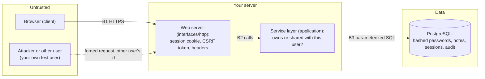

# Threat model of the notes app

The lesson's step 1 and step 6 in one document: the STRIDE walk over each trust boundary, the control for each threat, the test that proves the control, and the risks accepted instead of fixed. A unit test (`tests/unit/test_threat_model_document.py`) parses the verification table below and fails when a "fixed" row names no test, names a test that does not exist, or when an accepted risk has no reason, so this page cannot drift from the suite.

## System and trust boundaries

| Boundary | Between | What crosses it |
| --- | --- | --- |
| B1 | Browser and web server | requests with a cookie and form or JSON input; HTML, JSON and headers back |
| B2 | Web server and service layer | validated values and the signed-in user's id; domain errors back |
| B3 | Service layer and database | bound parameters; rows back |

## STRIDE walk

Every boundary is walked through all six letters. A dash means the letter was considered and no distinct threat applies here; the threats that do apply are the rows of the verification table (T1 to T21).

| Boundary | Spoofing | Tampering | Repudiation | Information disclosure | Denial of service | Elevation of privilege |
| --- | --- | --- | --- | --- | --- | --- |
| B1 | T1 session theft, T2 fixation, T3 credential guessing | T4 CSRF | T8 no trail of sign-ins | T5 stored XSS, T6 framing and sniffing | T7 oversized bodies; A2 volumetric floods (accepted) | - |
| B2 | - | T10 mass assignment | T11 no trail of denied access | T13 user enumeration, T14 secrets in logs | - | T9 reading or changing another user's note, T12 reader editing a shared note |
| B3 | - | T15 SQL injection, T18 audit tampering | T18 audit tampering | T16 password storage, T17 sessions readable from the database | T20 expired sessions piling up | T19 the app's database role changing the schema |

## Verification note: threats, controls and the tests that prove them

A row is "fixed" only when a passing test is linked. `make test-security` runs the security tests; `make prove` runs them again with each control removed and shows the linked test fail (see the README).

| ID | Boundary | STRIDE | Threat | Control | Proving test | Status |
| --- | --- | --- | --- | --- | --- | --- |
| T1 | B1 | Spoofing | Session theft: script reads the cookie, or it travels over plain HTTP | Opaque 256-bit id in a `__Host-` cookie with `HttpOnly`, `Secure`, `SameSite=Lax`; only the SHA-256 of the id is stored | `tests/security/test_session.py::test_session_cookie_flags` | fixed |
| T2 | B1 | Spoofing | Session fixation: an id planted before sign-in survives it | New session id and CSRF token at sign-in | `tests/security/test_session.py::test_the_session_id_changes_at_sign_in` | fixed |
| T3 | B1 | Spoofing | Credential guessing against one account | Failure throttle per client and username, with `Retry-After`; slow argon2id verification | `tests/security/test_authentication.py::test_repeated_failures_are_throttled_with_retry_after_and_audited` | fixed |
| T4 | B1 | Tampering | CSRF: another site makes the browser send a state-changing request | Per-session CSRF token required on every POST, PATCH and DELETE, plus `SameSite=Lax` | `tests/security/test_session.py::test_state_changing_request_without_csrf_token_is_refused` | fixed |
| T5 | B1 | Information disclosure | Stored XSS: a note's markup runs when another user opens it | Output encoding in the templates; a CSP with no script source | `tests/security/test_injection.py::test_hostile_content_is_rendered_as_inert_text` | fixed |
| T6 | B1 | Information disclosure | Clickjacking, MIME sniffing, referrer leakage | Security headers on every response | `tests/security/test_session.py::test_security_headers_on_every_response` | fixed |
| T7 | B1 | Denial of service | One request with a huge body | 64 KiB body limit; length limits in validation | `tests/unit/test_http_app.py::test_an_oversized_body_is_refused` | fixed |
| T8 | B1 | Repudiation | A sign-in or sign-out nobody can attribute | Audit row and log line per sign-up, sign-in, failure, throttle and sign-out | `tests/security/test_audit.py::test_sign_up_sign_in_failure_and_sign_out_are_audited` | fixed |
| T9 | B2 | Elevation of privilege | Reading, changing or deleting another user's note by changing the id in the URL | Authorization in `NoteService` on every request, answer looked up fresh; 404 for a note you may not see | `tests/security/test_authorization.py::test_user_a_cannot_read_update_or_delete_user_b_note` | fixed |
| T10 | B2 | Tampering | Mass assignment: `owner_id` in the request body | The service takes the owner from the session, never from input | `tests/security/test_authorization.py::test_the_owner_in_the_request_body_is_ignored` | fixed |
| T11 | B2 | Repudiation | An id-walking attempt leaves no trace | `note.access_denied` audit row and log line with the note id and the reason | `tests/security/test_audit.py::test_a_denied_note_access_writes_a_log_line_and_an_audit_row` | fixed |
| T12 | B2 | Elevation of privilege | A user a note is shared with edits, deletes or re-shares it | Access levels: shared means read only; 403 for the rest | `tests/security/test_authorization.py::test_a_user_the_note_is_shared_with_can_read_but_not_change_or_share_it` | fixed |
| T13 | B2 | Information disclosure | Telling "no such user" from "wrong password" | One message, one status, equal hashing effort for unknown users | `tests/security/test_authentication.py::test_unknown_user_and_wrong_password_look_identical` | fixed |
| T14 | B2 | Information disclosure | A password or note content ends up in a log | No logging of bodies; field-name redaction in the JSON formatter | `tests/security/test_passwords.py::test_passwords_are_salted_and_not_logged` | fixed |
| T15 | B3 | Tampering | SQL injection through note content, title or the sign-in form | Parameterized statements only; a quote is data | `tests/security/test_injection.py::test_hostile_content_is_stored_exactly_as_text` | fixed |
| T16 | B3 | Information disclosure | Passwords stored in plaintext or with a fast hash | argon2id with a random salt per hash | `tests/security/test_passwords.py::test_passwords_are_salted_and_not_logged` | fixed |
| T17 | B3 | Information disclosure | A database read yields live sessions | Sessions keyed by the SHA-256 of the cookie value | `tests/security/test_session.py::test_session_cookie_flags` | fixed |
| T18 | B3 | Tampering | Someone rewrites the audit trail | The app role has INSERT and SELECT only; a trigger refuses UPDATE and DELETE for every role | `tests/security/test_audit.py::test_the_application_role_cannot_change_or_delete_audit_rows` | fixed |
| T19 | B3 | Elevation of privilege | A compromised app changes the schema | The app connects as a role with no DDL rights | `tests/integration/test_database.py::test_the_application_role_cannot_change_the_schema` | fixed |
| T20 | B3 | Denial of service | Expired and anonymous sessions pile up | Anonymous sessions live 15 minutes; expired rows are purged at every sign-in | `tests/integration/test_repositories.py::test_purging_removes_only_expired_sessions` | fixed |
| T21 | B1 | Information disclosure | A forged request goes unnoticed | `csrf.rejected` audit row | `tests/security/test_audit.py::test_a_forged_request_is_audited` | fixed |

## Accepted risks

| ID | Risk | Why it is accepted here |
| --- | --- | --- |
| A1 | An attacker with physical access to the database server, or root on it, reads or rewrites every table | An application-layer project cannot defend a host it does not control. The infrastructure layer owns it: disk encryption, network isolation, access control on the host and backups. Mentioned so it is a decision, not an omission. |
| A2 | Volumetric denial of service: a flood of requests that no request-level rule can absorb | Absorbing a flood is the job of the edge (a CDN, a load balancer, a web application firewall). The app limits what one request can cost (body size, hash cost, the sign-in throttle), not how many arrive. |
| A3 | Account takeover through a stolen or reused password with no second factor | The lesson scopes multi-factor authentication out. Length rules and the sign-in throttle raise the cost of guessing; they cannot stop a correct password entered by the wrong person. A second factor is the next control to add. |
| A4 | Passwords that appear in public breach lists are accepted if long enough | A breached-password check needs an external service or a large local list. The 12 character minimum and the throttle are what this build offers. |
| A5 | Plain HTTP between the browser and the app when no TLS terminator sits in front | The app sets `Secure` cookies and HSTS and assumes HTTPS is terminated by a proxy; running it without one defeats those controls. The README says so, and `TRUSTED_PROXY_COUNT` is how the app learns about the proxy. |
