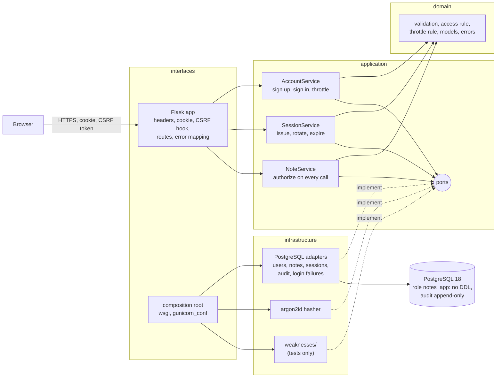

# Markdown and Mermaid (the documents)

## What it is

**Markdown** is a way of writing formatted documents in plain text. You mark headings with `#`, lists with `-`, emphasis with asterisks, code with backticks, and tables with `|`. A program (GitHub's page, an editor preview) turns the plain text into a formatted page. The files end in `.md`. **Mermaid** is a small language for drawing diagrams from text. A **fenced block** (a block of lines between two lines of three backtick characters) whose opening fence is followed by the word `mermaid` is drawn as a diagram by GitHub and by many editors. The text stays readable in a plain editor and is easy to review in a change.

## Why this repository uses it

The lesson asks for documents as well as code: a README that proves each requirement, an architecture document with a diagram, short records of decisions (**ADRs**, architecture decision records), a threat model, and a changelog. Plain text files that live next to the code change with the code, are reviewed with the code, and are checked by tests: `tests/unit/test_threat_model_document.py` reads `docs/THREAT_MODEL.md` and fails if a "fixed" threat names a test that does not exist.

## Where it appears

| Path | What it is |
| --- | --- |
| `README.md` (194 lines) | The entry point: what the project is, how to set it up, run and test it, and for each "done when" line of the lesson how the README proves it. |
| `ARCHITECTURE.md` (98 lines) | The layers, a Mermaid diagram of the components, one request step by step, decisions, failure modes, limits, how to extend. |
| `CHANGELOG.md` (14 lines) | What changed in each version, in the Keep a Changelog format. |
| `docs/THREAT_MODEL.md` (78 lines) | The STRIDE walk, the verification table, accepted risks (`tech/stride-threat-modeling.md`). |
| `docs/adr/0001` to `0004` | Four decision records: server-side sessions, deliberate weaknesses, 404 instead of 403, throttle state in PostgreSQL. |
| `tech/*.md` | These notes. |

## How it works underneath

1. A Markdown file is ordinary text. A **renderer** reads it line by line and builds the formatted page.
2. The syntax used in this repository:
   - `# Title`, `## Section`, `### Subsection`: headings, by number of `#`.
   - A blank line separates paragraphs. Two spaces at the end of a line force a line break.
   - `- item` or `1. item`: bullet and numbered lists.
   - `**bold**`, `*italic*` (or `_italic_`), and text in backticks for inline code.
   - Three backticks on a line of their own open and close a block of code; the word after the opening fence (`python`, `bash`, `mermaid`) names the language so the renderer can color it.
   - `[text](address)`: a link. `[text](docs/adr/0001-server-side-sessions.md)` is a relative link to another file in the repository.
   - A table is rows of cells between `|` characters, with a second line of `---` under the header row.
   - `> text` is a quotation.
3. Mermaid is drawn in the browser from the text between the fences; it does not change the Markdown file.

## Walkthrough of this repository's use

### The README

The header table gives the lesson address, planned hours, level and links. The sections are: Prerequisites; "Setup, run, test, stop" (the exact commands); "The SQL" (what each file under `sql/` is for); "Done when: the lesson's checklist and the proof for each line" (each requirement from the lesson, the command that shows it, and the real output); "Stretch goals"; "What is simplified for teaching"; "Project structure" (a text tree of the folders); and "Author and license".

### The architecture document and its diagram



- `flowchart LR` starts a flow diagram laid out left to right.
- `browser["Browser"]` defines a **node**: the word before the brackets is its id, the quoted text is the label. `<br/>` inside a label is a line break. `(("ports"))` draws a circle, `[("...")]` a cylinder (a database).
- `subgraph name["label"]` ... `end` draws a labeled box around the nodes inside: the four layers.
- `a --> b` is an arrow; `a -- "text" --> b` puts text on it; `a & b --> c` draws arrows from both a and b to c; `-. text .->` is a dotted arrow (used for "implements").

So the picture says: the browser reaches the Flask app; the Flask app calls the three services; the services use the rules and the ports; the PostgreSQL adapter, the hasher and the test-only weaknesses implement the ports; the composition root wires them; the adapter talks to the database.

### An ADR

Each decision record has the same sections: a numbered title (`# 1. Server-side sessions with an opaque id`), a date and status line, **Context** (the problem), **Decision** (what was chosen), **Alternatives** (what was not, and why), **Consequences** (what the choice costs and gains). A reader a year later can see why the code is the way it is. ADR 3 (`not-found-for-notes-you-cannot-see`) explains why a foreign note answers 404 rather than 403: a 403 would confirm the id exists.

### The changelog

Follows Keep a Changelog: a heading per version with a date (`## [0.1.0] - 2026-10-27`), then `### Added` with bullets. The project uses Semantic Versioning: `MAJOR.MINOR.PATCH`.

### The threat model, checked by a test

The verification table is the only Markdown in the repository that a program parses. The test finds the first table under the heading `## Verification note`, splits each row on `|`, and for every row extracts the test reference with a regular expression for `tests/<path>.py::<name>` in backticks, then looks for `def <name>(` in that file. A broken reference fails the build.

## Try it yourself

1. Read the diagram's source and preview it: open `ARCHITECTURE.md` in GitHub or an editor with Markdown preview. The Mermaid block renders as a boxes-and-arrows picture.
2. Count the threats the test sees:
   ```bash
   grep -c "^| T[0-9]" docs/THREAT_MODEL.md
   ```
   Expect `21`.
3. Run the test that reads the document:
   ```bash
   .venv/bin/pytest tests/unit/test_threat_model_document.py -v
   ```
   Expect four `PASSED`.
4. Break a link on purpose (then revert): in `docs/THREAT_MODEL.md` rename a test in the T9 row and rerun step 3; expect `does not exist`. Restore with `git checkout docs/THREAT_MODEL.md`.
5. List the ADRs: `ls docs/adr`. Expect four files numbered `0001` to `0004`.

## Mistakes people make

- Documents that drift from the code. Here the threat model is parsed by a test; the README's outputs were pasted from real runs.
- Links with absolute paths that only work on one machine. Relative links work for everyone.
- Pictures of diagrams that cannot be edited. Mermaid is text and shows up in diffs.
- Forgetting the blank line before a table or list, which makes the renderer treat it as part of the paragraph above.
- Putting secrets or real credentials in a document. None appear in these.

## Check yourself

1. How do you write a level-two heading?
   *`## Heading`.*
2. What does the word after the opening code fence do?
   *Names the language so the renderer can color it (`bash`, `mermaid`).*
3. What does `a & b --> c` mean in Mermaid?
   *Arrows from both a and b to c.*
4. What are the four sections of an ADR here?
   *Context, Decision, Alternatives, Consequences.*
5. Which document is checked by a test?
   *`docs/THREAT_MODEL.md`, by `test_threat_model_document.py`.*

## Further reading

- Markdown guide (CommonMark): https://commonmark.org/help/
- GitHub-flavored Markdown (tables, task lists): https://github.github.com/gfm/
- Mermaid flowcharts: https://mermaid.js.org/syntax/flowchart.html
- Architecture decision records: https://adr.github.io/
- Keep a Changelog: https://keepachangelog.com/en/1.1.0/
- Semantic Versioning: https://semver.org/
